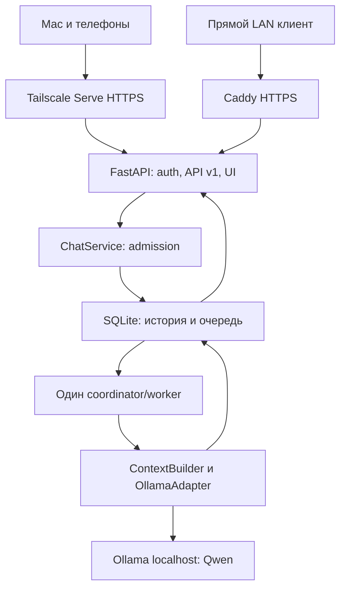

# Bublik Private AI Service — архитектура runtime0.8.0

Основа курса: main commit `218bc3544f114275db76906a52d38289ce8ff37b`.
Отдельный каталог дня30, public API v1, SQLite schema2, private-chat-v2.
Реализованы этапы1–9. Детальные evidence и ограничения: FINAL_REPORT.ru.md.
Облачные LLM/fallback, RAG по умолчанию, voice/MCP/tools/agents не входят в задачу.
Rust — отдельное будущее исследование, не текущая реализация.

## Доступ и границы доверия

| Путь | Вход | Условия |
|---|---|---|
| Mac/Android/iPhone дома и снаружи | Tailscale Serve HTTPS443 | Tailnet connectivity, policy, собственный login Бублика |
| Прямой домашний LAN | Caddy `https://LAN_IP:8443` | Trust собственного CA, matching origin; Tailscale не обязателен |
| Другие приложения | Тот же HTTPS `/api/v1` | Scoped/expiring/revocable personal Bearer token |

Serve — основной проверенный мобильный путь; телефонные LAN CA настройки отложены.
API слушает только `127.0.0.1:8000`, Ollama — literal localhost11434. Proxy connects
по loopback. Public Funnel/router port forwarding не используются. Mac должен быть
awake/online; API/Caddy LaunchAgents запускаются после user login, Ollama/Tailscale
подключаются отдельно. LaunchAgent не гарантирует обслуживание до login или при sleep.

LAN Caddy config разрешает один конкретный RFC1918IPv4:8443, tls internal,
admin off, HTTP redirect listener off, runtime logs discard. CA/state остаются
в постоянном private data directory вне checkout. Смена DHCP IP требует согласованных
обновлений bind/origin/certificate; лучше фиксированный lease.

У LAN IP и tailnet hostname разные cookies/origins; история общая для одного owner.
Сеть/устройство не задают владельца. XFF/Tailscale identity headers не авторизуют
пользователя и не меняют rate keys. Local OS — доверенная граница; malicious local
process не отделён от proxy только заголовками.

Режим `--trusted-loopback-proxy` принимает actual raw loopback peer и ровно один
`X-Forwarded-Proto:https`. Uvicorn proxy_headers=False; Host allowlisted, optional
XFH должен совпадать, Forwarded chains/duplicate protected headers отвергаются.
Plain HTTP backend без proxy marker возвращает400. CSRF проверяет exact external
Origin, включая login/logout; один разрешённый origin не считается другим.
HSTS86400s без preload/includeSubDomains. В direct TLS режиме прежняя защита сохраняется.

## Компоненты

| Модуль | Ответственность |
|---|---|
| domain.py / settings.py | Состояния, ошибки, ModelProfile, immutable prompt registry, limits |
| storage/database.py / migrations | Private DB, atomic versioned migrations, WAL/FULL |
| storage/repository.py | Owners, transactions, admission, receipts, pagination/export/backup |
| storage/worker.py | Единственный worker lease, claim/checkpoint/finish и recovery gate |
| inference/context.py | Проверяемый суффикс истории и conservative token upper bound |
| inference/engine.py | OS listener epoch, same-UID process topology/no-orphan checks |
| inference/ollama.py | Async local HTTP, model/template checks, bounded streaming/parser |
| inference/coordinator.py | Lifespan, durable queue dispatch, timeout/uncertain handling |
| service.py / security.py | Async transaction boundaries, password/session/token/quotas |
| http_api.py | Authenticated API, HTTPS/proxy/Origin/CSRF, errors, SSE, static allowlist |
| web_ui/ | Responsive plain-text chat, safe snapshot replacement, polling, PWA manifest |
| admin_cli.py / local_cli.py | Local operator management, terminal chat/doctor/recovery |

Один процесс API, один worker, одна active generation. Модель не находится в Python.
Durable queue в SQLite — источник истины; in-memory wakeup лишь ускоряет polling.
Несколько Uvicorn workers/reload не поддерживаются. Async storage calls передают
целую синхронную transaction operation в thread executor, не делят её на await/SQL.
По соединению на операцию; shared global sqlite connection отсутствует.

## Поток сообщения и повторы

1. HTTPS/auth определяет owner; request не задаёт owner/model/URL/system roles.
2. Проверяются body, JSON fields, CSRF/Origin, quotas, readiness и context budget.
3. `BEGIN IMMEDIATE`: проверка idempotency/revision/capacity/current context и
   atomic insertion user message, assistant placeholder, job snapshots и receipt.
4. После commit —202 с durable IDs. Это admission, не completed answer.
5. Worker claim записывает running, inference выполняется вне SQLite transaction.
6. Saved partial checkpoints/terminal result читаются через GET/SSE/polling.
   Disconnect subscriber не отменяет вычисление. UI заменяет snapshot, не append
   повторно полученный prefix. Unsaved tokens не объявляются persisted history.

Same key+original payload возвращает прежниеIDs/receipt; changed payload409.
Replay идёт до новой revision/capacity/context проверки, но после owner/security;
не расходует новую inference quota, general HTTP quota действует. Receipts durable,
не автоматически expire. Model default update не меняет принятый job.
`chat.revision` меняется на admission/terminal transition, не каждый partial chunk.
SQLite trigger поддерживает отдельную durable SSE message revision.

Generation: queued→running→completed|truncated|failed|interrupted. Queue expiry600s
сохраняет вопрос и failed/queue_expired. Retry только последнего retryable question,
с new generation/assistant attempt, без вставки user message заново. Completed/older
regeneration, editing/delete/branching не входят в APIv1.

## History, context и обновление модели

Полная история хранится независимо от модели/context. ContextBuilder выбирает
последовательный суффикс completed pairs, system prompt и новый вопрос. Failed,
interrupted/truncated ответы не становятся ordinary context автоматически.
Omitted turns видны; оригиналы не удаляются и не заменяются summary.

Профиль0/8192/1024/margin512: input upper bound+output+margin≤8192, budget6656.
Verified byte-BPE upper bound учитывает поддерживаемый Qwen template и overhead;
unknown template/digest не принимается как безопасный счётчик. Это conservative
bound, не точный tokenizer. Новый вопрос/system не silently truncated; oversize422
до admission. Actual prompt counts/bounds сохраняются в контролируемых live reports.

ModelProfile/private-chat-v1 и v2 имеют immutable registry texts. Новый ход поумолчанию
v2; старые profile/context/answer/IDs не переписываются. Persisted и dispatched prompt
проверяются на совпадение до POST. Startup отказывает queued_profile_mismatch до claim
при старых queued profiles; matching `--prompt-version private-chat-v1` позволяет
дренировать их, затем обновить defaults. Нельзя менять job snapshot ради обновления.
Замена модели в будущем требует identity/context-policy проверки и новый baseline;
история/owners не пересоздаются.

## Storage и recovery

SQLite application_id, WAL, foreign_keys=ON, synchronous=FULL, busy timeout,0600.
Миграции001/002 атомарны, ledger хранит name/version/SHA. Foreign DB, изменённая
released migration и неизвестная newer schema отвергаются. После release добавляются
новые миграции; старые SQL не редактируются.

Tables: users/chats/messages/generations/idempotency/chat_events/service_state/
schema_migrations, browser_sessions/api_tokens/rate_events. History paginated.
Export — consistent WAL snapshot без password hashes/worker token; сейчас материализуется
в памяти. Backup через sqlite backup API учитывает committed WAL, проверяет integrity,
FKs/application_id и публикует новый файл без overwrite. Operational restore/off-host
copies/retention отложены. FULL/transactions не защищают от потери диска.

Worker получает nonblocking POSIX flock по DB device/inode; второй процесс/hardlink
alias не может восстановить живой ход. SQL ограничивает один running globally и
один queued/running наchat. Worker capability проверяется на checkpoint/finish,
closed/fork-inherited session не может продолжать writes.

На restart старые running становятся interrupted, saved partial остаётся. Queued
не теряются; они ещё не выполнялись. Uncertain external inference включает durable
gate: new admission/claim блокируются, history доступна. Timeout/read/stream failures
могут установить gate, потому что disconnect HTTP не доказывает остановку Ollama.
Exactly-once внешнего inference при произвольном crash не обещается.

Explicit recovery проверяет no dispatch либо новый OS engine epoch/sameUID listener
и отсутствие orphan Ollama runners. Один `/api/ps` не доказывает idle. Gate не снимается
SQL обходом; API остановлен, оператор явно restarts Ollama, затем recover-inference.
Новых automatic inference replay/cloud requests нет. Реальнаяv1 chain с partial707chars
принята; currentv2 stream/recovery logic не переписывалась.

## Security, limits и ресурсы

Argon2id passwords, opaque server sessions, Secure/HttpOnly/SameSite=Strict cookie,
rotation/revocation/expiry, exact Origin/CSRF. Local CLI выдаёт scoped expiring tokens,
DB хранит hashes; password change отзывает sessions/tokens. No public signup/token
issuance через HTTP. Foreign/unknown IDs404. Cookies+Bearer ambiguity отвергается.
Никаких browser API keys/query credentials/localStorage history или внешних CDN.

Body32KiB/deadline10s, user16KiB/output64KiB, max output1024tokens. Quotas durable
sliding-window:10accepted/min/owner,120HTTP/min/owner, auth/login peer limits.
Quotas+admission atomic, replay не добавляет inference debit. Eight queued/three
outstanding owner/one inference; engine deadline300s/connect3s/read30s, keep_alive5m.
SSE2/user/8global, heartbeat10s/lifetime900s, credential checks во время stream.
Readiness cached5s/bounded5s, gate/queue проверяются каждый call.

Private responses no-store, plain text UI, no service worker/private caching.
Production access logs disabled; errors omit private input/secrets/upstream tracebacks.
Launchd stdout/stderr=/dev/null — private but limited diagnostics; structured redacted
logging/rotation backlog. Host/policy/session controls не являются pentest certificate.

Measured API RSS/CPU отдельно от Ollama family RSS/reported allocation/swap.
RSS+size_vram не складываются в physical unified-memory peak; GPU не измерен.
Другие Ollama clients могут обойти queue и загрузить дополнительные модели: сервис
не скрытно выгружает их и не гарантирует exclusivity engine. Приёмка в отдельном
окне без RAG/Revik/bge-m3. keep_alive не является доказательством экономии памяти.

## Переиспользование и корпус документов

Переиспользованы принципы Day18 lifecycle, Day25 persistence/ownership, Day26 local
HTTP/model validation, Day29 profile/resource evidence. Day25 CLI/ChatStore не
объявляется конкурентным web server; у day30 свои transactions/owners/jobs.
Day29 mutable interceptors/V7 RAG patches не становятся HTTP handlers. Старые lesson
sources/tests/JSON не меняются. Day30 не зависит от embedding/index.

Root README обновлены на этапе9: они входят в Day21 corpus и меняют fingerprint.
Rebuild/verify перед следующим строгим RAG live run, не перепись old reports.
Модель, сервис, UI и долговременное хранилище имеют отдельные границы.
Стабильные IDs, исходная история и версионируемые миграции сохраняют данные
независимо от модели. Сохранённая история не означает, что модель одновременно
видит её всю. Перенос железа требует проверенного восстановления.
Rust/Axum/Tokio — отдельный after-course API overhead benchmark, не снижение Qwen/KV RAM.

## Primary references

- [Ollama chat API](https://docs.ollama.com/api/chat)
- [Ollama FAQ](https://docs.ollama.com/faq)
- [Tailscale Serve](https://tailscale.com/docs/features/tailscale-serve)
- [Tailscale grants](https://tailscale.com/docs/reference/syntax/grants)
- [SQLite backup](https://sqlite.org/backup.html)
- [SQLite pragmas](https://sqlite.org/pragma.html)
- [Python3.13 sqlite3](https://docs.python.org/3.13/library/sqlite3.html)
- [OWASP session management](https://cheatsheetseries.owasp.org/cheatsheets/Session_Management_Cheat_Sheet.html)
- [OWASP CSRF prevention](https://cheatsheetseries.owasp.org/cheatsheets/Cross-Site_Request_Forgery_Prevention_Cheat_Sheet.html)

Ссылки описывают APIs/principles, не заменяют фактические reports.
