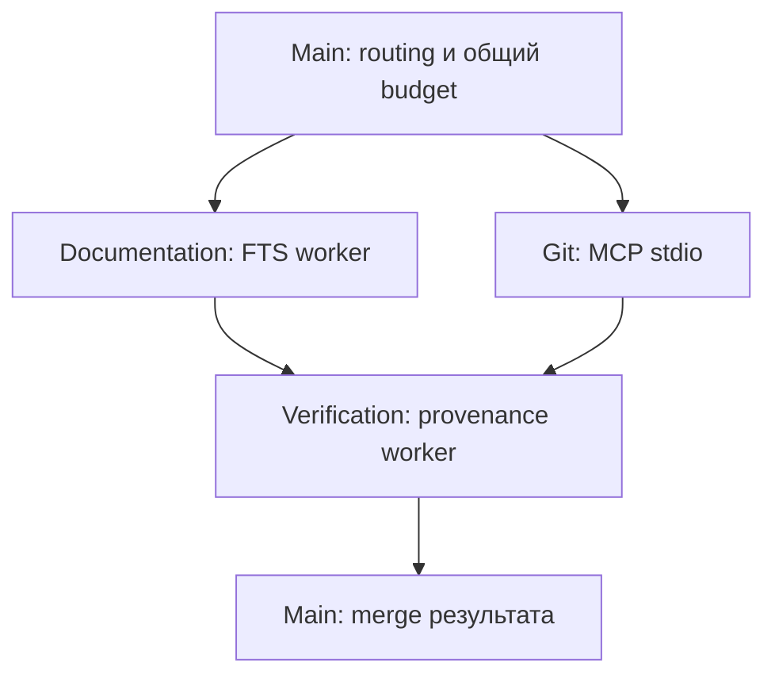

# Архитектура проверенного Course Minimum

База — App0.7.29. Для модельной публикации используется **внешняя копия** с Publication Gate v104-r2 и существующим source-anchor producer v103. Установленный CLI не заменён, production44 и research54 разделены. Никакой новой архитектуры Stage8 не вводит.

## Реальная делегация без модели

`agents demo` использует существующий Dispatcher. Main создаёт ограниченные TaskEnvelope/ContextEnvelope; Documentation и Git выполняют собственные задачи, Verification зависит от их результатов, затем Main merge. Это настоящий runtime, а не имитация по именам ролей.

В этой схеме **0 model calls**. Documentation/Verification — owned subprocess workers; Git — scoped MCP client/server. Task/context digests и lifecycle SPAWN/EXECUTE/REPORT/MERGE сохраняются; worker cleanup фиксируется WORKER_REAPED. Наличие отдельных task contexts не означает отдельный LLM для каждой роли.

## Принятый RU1/Multi путь с моделью

1. Launcher r3 проверяет source/package/session/index/Git pins и прежний preflight receipt. Создаётся свежая Documentation/Verification acquisition на FTS54. Sources и previews обязаны совпасть с frozen v103 selection/context.
2. До dispatch сохраняется exclusive single-call reservation. SnapshotPipeline логически переиспользует только что полученную acquisition; в model trace это SNAPSHOT_REPLAY. Одна Documentation inference task запускается в собственном worker; Main не вызывает дополнительную модель. В этом вопросе Git operation не требуется; реальный Git отдельно показан preflight/demo.
3. Capture worker передаёт прежние messages/schema/options локальной Qwen, сохраняет dispatch fingerprint и полный raw response. Один chat, без model retry/cloud fallback. Существующий session lease/uncertain checkpoint остаётся авторитетным; crash не разрешает тихую повторную генерацию. Keep_alive=0s задан прежним producer.
4. Runtime проверяет формат, identifiers/paths, принадлежность и точность выбранных цитат, финальный provenance. Publication adapter сохраняет claim text, собственный exact anchor, normalized offsets/line ranges, source fingerprints, task/result version и binding. К цитате нельзя задним числом добавить другие документы.
5. Technical PASS оставляет needs_review/answer_accepted=false. Пользователь явно оценивает смысл каждой claim и принимает/отклоняет полноту. Доверенный локальный operator ID применяется извне файла решения; это не механизм цифровой аутентификации.
6. `entry.py publish` повторно проверяет весь immutable envelope и review bindings, затем создаёт закрытую public projection. Все claims должны быть supported с human review и runtime_passed; unsupported/needs_review или runtime refusal не дают положительный ответ. Нативный audit/raw/старый withheld result не переписываются. Для публикации модель/retrieval/index не нужны.

Это не полная реализация многозадачного model Chain; один Qwen context не называется двумя независимыми contexts. Public renderer не пропускает произвольные native поля; JSON/text consumers используют тот же gate.

## Источники и границы

- Production44/405 сохраняется отдельно; research54/510 содержит явный manifest и нужен RU1 (Day7 README). Generic CLI FTS demo и frozen research selector — разные способы выбора из существующего индекса; demo не калибрует producer и не меняет его evidence.
- Текст нормализуется в UTF-8/LF, точные spans/строки и raw/text digests сохраняются. Exact quote/identifier checks необходимы, но не доказывают semantic entailment.
- Verification проверяет provenance/schema и связи tasks. В pipeline `semantic_support_verified=false` исходно честно отражает отсутствие его собственной semantic review. Новый результат human gate хранит semantic_acceptance отдельно.
- Полнота рубрики оценивается отдельно от grounding. В RU1 принято ограничение причинного объяснения; source anchors и ответ ради этого не дописывались.
- Path/role/schema/deadline/call-budget guards и Git read-only capabilities сохраняются. Application capability isolation предполагает доверенный Python-код и не является OS sandbox.

## Доказательства и незавершённая часть

Mac preflight32, один настоящий RU1 Qwen run и финальная Mac публикация verified. Сводка — [MAC_PUBLICATION.ru.md](MAC_PUBLICATION.ru.md). Unit fixtures с model transport/human reviewer синтетические; текущая генерация и конечное решение пользователя реальные. Исторические known22/шесть вопросов и старые дефекты не становятся current quality PASS.

Course Minimum Accepted. Research Stage7 остаётся paused/incomplete: [BACKLOG_AFTER_COURSE.ru.md](BACKLOG_AFTER_COURSE.ru.md). Stage9/PR не выполнялись.
